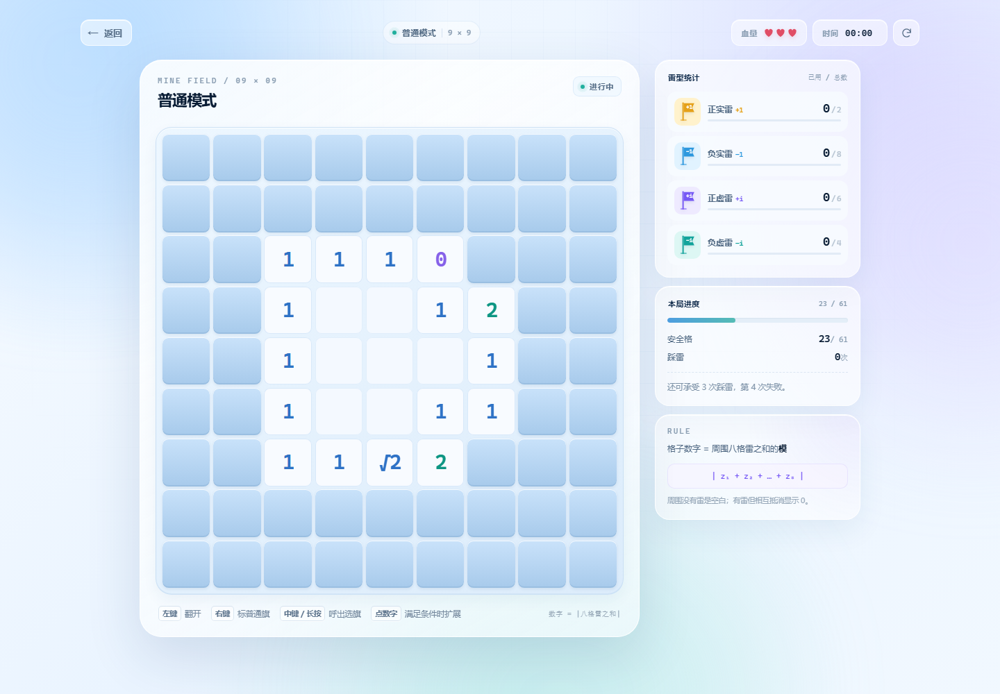

# 复数扫雷 / Complex Minesweeper

一个把经典扫雷改造成“复数运算”的网页小游戏。

雷不再只有一种，常规模式有 **+1、-1、+i、-i** 四种，地狱模式还会加入 **0** 雷。每个数字格显示的不是周围雷的数量，而是周围八格雷的**复数之和的模长**：

$$
\text{数字} = \left| \sum_{k=1}^{8} z_k \right|
$$

所以数字可能是 `0`、`1`、`2`、`√2`、`√5`……只看数量已经不够，还要判断正负和实虚方向。


## 游戏截图

| 对局 | 结算 |
| --- | --- |
|  |  |


## 玩法

### 基本规则

- 普通模式：**9 × 9** 棋盘，**20 颗雷**，**3 点血量**，**61 个安全格**。
- 困难模式：**15 × 15** 棋盘，**47 颗雷**，**4 点血量**，**178 个安全格**。
- 地狱模式：**11 × 11** 棋盘，**25 颗雷**，**4 点血量**，**96 个安全格**，额外加入零雷。
- 每次踩雷扣 1 点血量；血量归零后再踩一次雷判负。
- 翻开全部安全格即胜利，不要求把所有雷都插旗。
- 第一次翻开的格子一定安全，且会避开以它为中心的 3×3 区域。
- 空白格表示周围没有雷，会自动扩散翻开。
- `0` 表示周围有雷，但复数相加后互相抵消，不会扩散；零雷本身也显示 `0`，不改变周围数字的模。

### 难度

| 难度 | 棋盘 | 雷数 | 血量 | 安全格 |
| --- | --- | --- | --- | --- |
| 普通 | 9 × 9 | 20 | 3 | 61 |
| 困难 | 15 × 15 | 47 | 4 | 178 |
| 地狱 | 11 × 11 | 25 | 4 | 96 |

### 教程

主菜单的“教程 · 5 步上手”会打开内置教程，依次讲解：

1. 数字为什么是模长，而不是雷数。
2. 空白格和数字 `0` 的区别。
3. 左键、右键、中键 / 长按与选旗轮盘。
4. 数字扩展的数量与复数条件。
5. 血量、踩雷和胜利条件。

可以点上一步 / 下一步或步骤点切换，键盘 `←` / `→` 也能翻页，`Esc` 返回主菜单；最后一步可直接进入难度选择。

### 五种雷

| 旗子 | 名称 | 复数 |
| --- | --- | --- |
| 橙色 `+1` | 正实雷 | `1` |
| 蓝色 `-1` | 负实雷 | `-1` |
| 紫色 `+i` | 正虚雷 | `i` |
| 青色 `-i` | 负虚雷 | `-i` |
| 灰色 `0` | 零雷 | `0` |

普通和困难只有前四种雷；地狱会额外加入零雷。每局开始时，当前模式的所有雷型各保底 2 颗，剩余的雷随机分配。侧栏会显示每种雷的 **已用 / 总数**，总数每局可能不同，但加起来一定是 20（普通）、47（困难）或 25（地狱）。零雷的 `0` 旗在数字扩展时计入“旗子数量”，复数为 `0`。

### 数字扩展

点击一个已经翻开的数字格，如果同时满足：

1. 周围八格中，**雷的数量 = 旗子数量**（普通红旗也计入数量）；
2. 所有**有类型的旗子**复数相加后的模，等于这个数字（普通红旗不参与复数计算）；

就会清除周围所有未被标记的格子，即使其中有雷。

例如数字为 `√2`，周围标记了 `+1` 和 `+i`，复数和为 `1+i`，模正好是 `√2`；如果旗子数量也等于周围雷数，就可以扩展。普通红旗只参与“数量”判断，不参与复数求和。

- 扩展踩中未标记的雷，只扣 **1 点血量**，不管一次踩中几颗。
- 条件不满足时会提示：`此数字无法扩展`。
- 被引爆的雷会显示出来，并计入对应雷型的“已用”统计。

## 操作

| 操作 | 效果 |
| --- | --- |
| 左键点击未知格 | 翻开 |
| 左键点击已翻开的数字格（周围有雷） | 尝试数字扩展 |
| 右键点击未知格 | 切换普通红旗；已有任意旗子则清除 |
| 中键点击未知格 | 呼出选旗轮盘 |
| 轮盘打开后左键点选项 | 放置 `+1` / `-1` / `+i` / `-i` / `0` / 清除（`0` 仅地狱） |
| 点击轮盘外空白 | 关闭轮盘 |
| 手机长按未知格 | 呼出选旗轮盘 |

选旗轮盘打开后，**只有点选项或点空白处才会关闭**；中键不会触发浏览器滚动。手机上下滑动不会误触发轮盘。

## 特性

- 纯 HTML / CSS / JavaScript，无构建步骤、无第三方运行时依赖。
- 所有游戏内雷、旗子、图标均由内联 SVG / CSS 绘制，不依赖外部图片素材。
- 内置 5 步教程：数字、0、操作、扩展、血量。
- 响应式布局，适配桌面、平板和手机；最窄验证到 320px。
- 首次点击安全，不会开局即踩雷。
- 五种雷（地狱含零雷）独立统计，雷被引爆后也会计入对应类型。
- 胜负结算弹窗：下一局、查看棋盘、返回菜单。
- 查看棋盘时会翻开剩余雷；正确的类型旗保留，错误旗或普通旗改为显示实际雷型并标错。
- 支持鼠标和触摸操作。

## 运行

直接双击打开 `index.html` 即可。

也可以在目录里启动一个本地静态服务器：

```bash
python -m http.server 8000
```

然后访问 `http://localhost:8000`。

## 文件结构

```text
复数扫雷/
├── index.html          # 页面结构：菜单、教程、棋盘、选旗轮盘、结算弹窗
├── style.css           # 视觉、响应式布局、教程、棋盘/旗子/雷的样式
├── script.js           # 游戏逻辑：教程、布雷、计算、扩展、统计、计时、结算
├── preview/            # README 截图
│   ├── menu.png
│   ├── game.png
│   ├── win.png
│   ├── hell.png
│   └── tutorial.png
└── README.md
```

发布版不含踩雷表情素材，避免公开仓库出现第三方美术资源。

## 实现说明

- 雷在第一次翻开时才生成，并排除首次点击的 3×3 区域，保证首点安全。
- 每个格子的值存的是模的平方，显示时写成 `√n`；完全平方数显示为整数，避免浮点误差。
- 数字扩展用“模的平方”比较，不直接比较浮点数。
- 雷型统计会计入：已放置的类型旗、已引爆的雷；普通红旗不计入类型统计。
- 结束一局后会停止计时，并锁定棋盘输入；点击“查看棋盘”会关闭弹窗，方便查看终局。
- 页面不使用框架，逻辑集中在 `script.js` 的 IIFE 中。

## 浏览器

建议使用较新的 Chrome、Edge、Firefox 或 Safari。项目使用了 CSS 变量、`backdrop-filter`、Pointer Events 等现代特性。

## 后续计划

- 更完整的胜负过场与音效。
- 更多教程关卡与交互式练习。

## 说明

这是个人练习项目，规则和视觉均在经典扫雷基础上做了复数主题改造。欢迎提 Issue 或 PR。
